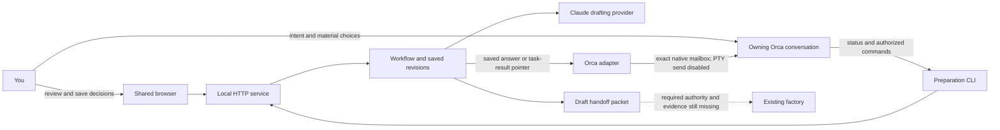

# Orca and the local preparation service

The browser and CLI use one workflow service at `http://127.0.0.1:4317`. Orca hosts the owning Claude or Codex conversation. The adapter implements explicit native chat creation, accepted model preferences, exact session pairing and revision-bound status pointers through Orca's existing durable mailbox. Fake RPCs cover this route. Requested settings and provider-confirmed active settings are reported separately. Existing PTY sessions can be paired, but their unsafe prompt-delivery fallback remains disabled.



## Responsibilities

| Participant | Owns |
| --- | --- |
| You | Product intent, material scope and stack choices, artifact review and requested changes. |
| Orca conversation | Reusing saved answers, issuing authorized CLI commands, inspecting results and explaining blockers. |
| Browser and CLI | Two interfaces to the same service; neither writes preparation files directly. |
| Workflow service | Preparation identity, revisions, operation IDs, immutable artifacts, task state and downstream invalidation. |
| Drafting provider | Text generation through the existing Claude login, with model tools/MCP disabled and bounded calls. Calling from Codex does not switch providers. |
| Orca adapter | Explicit native session creation/configuration, one service-to-owner pairing and truthful notification receipts. A pointer grants no authority. |
| Existing factory | Its own reviews, human approvals, protected acceptance evidence, locks and dispatch rules. Those integrations remain unfinished. |

No folder watcher, manual file relay, separate session host, panel extension or new approval engine is required. `orca-open` uses Orca's existing workspace browser tab; `open` uses the OS default browser. Local saved artifacts are workflow evidence, not a transport inbox.

## Start and use the preparation

### Named project workspaces

In the Session drawer, enter a **Project workspace name**, save the agent preferences, then choose **Start workspace + …**. The launcher creates a top-level Orca worktree in the current repository from that repository's configured default base, reveals it in the project sidebar, and creates the selected native chat inside that worktree. Setup hooks are explicitly skipped. No prompt, builder, gate approval or factory record is generated.

After accepting the selected model settings, the launcher explicitly reveals the exact native chat for both Claude and Codex. **Open connected chat** returns to that same chat; the CLI equivalent is `orca-reveal --url URL`. A failed reveal retains the created session and reports the failure, without creating a replacement or sending a prompt. Opening the chat does not start a model turn.

The service and saved preparation stay where they are; the workspace association and recipient are saved with the preparation. A fresh worktree contains the repository's committed base, not the current working directory's uncommitted files. This does not install the preparation service or authorize an application build in that checkout.

CLI equivalent: `npm run --silent cli -- orca-start --workspace-name "Equipment Checkout" --url http://127.0.0.1:4320`. Without `--workspace-name`, the existing current-workspace session route remains available for compatibility. Once a preparation has a named workspace, discovery, pairing and later launches use that saved workspace. `orca-open` opens the shared page in the selected workspace.

If an owner is already connected, disconnect it before creating the project workspace. Disconnecting preserves its chat; it does not move, stop or delete it. The new owner is explicitly created in the named worktree. A repeated successful request reuses its saved result; a partial or uncertain workspace creation stops without creating another worktree or chat. The result must be inspected before recovery.

Notifications verify the original service sender in its original workspace and the exact recipient in the selected project workspace. The service remains the single owner of its saved data. Cross-workspace notification behavior is covered by the transport tests; a delivered receipt still means enqueue only, not user approval or completed work.

From `orchestration/` in an Orca agent session, start the single service owner. This captures the service's actual Orca sender handle; an ordinary shell without that identity cannot deliver native mail:

```sh
npm ci
npm run build
npm start
```

In the owning Orca conversation, use the same service:

```sh
npm run --silent cli -- status
npm run --silent cli -- orca-open
npm run --silent cli -- orca-preferences --provider claude
npm run --silent cli -- orca-start
npm run --silent cli -- orca-status
```

Opening a tab does not prove review. Orca and the preparation service must stay running; the native conversation may be idle. `orca-start` explicitly creates a session, checks Orca accepted the exact requested model/effort settings, and pairs its exact identity. It sends no initial prompt to force provider confirmation; that may remain pending until an ordinary turn. A partial or uncertain create is retained without automatic replacement or retry. Read the [portable preparation skill](skills/pod-preparation/SKILL.md) when using the CLI through Claude or Codex. See [README](README.md) for operation IDs and provider limits.

The [live evidence](evidence/orca-native-live.json) records one created Claude chat that initially remained partial under the earlier provider-confirmation requirement. The same chat was then explicitly paired after inspection of its exact successful setting receipts, without another create or option mutation. Orca durably enqueued the smoke notification, woke Claude and observed it read and report the message; the completed turn reported `claude-opus-5-5`. This proves that bounded native wake/read path, not automatic continuation of product work or the complete create-to-continuation journey.

The recipient made three read-only mailbox/help tool calls and declined the requested exact reply and mailbox acknowledgment because the message came from an agent. No product work or factory approval occurred. The chooser now accepts requested settings while reporting provider confirmation separately; it does not send an initial paid turn just to confirm a model.

Saved owner preferences default to Claude Opus 5.5 (`claude-opus-5-5`) with medium effort, or Codex GPT-6.1-Sol (`gpt-6.1-sol`) with high effort. Use `orca-preferences --provider codex` to choose Codex; optional `--model ID --effort low|medium|high` saves overrides. Saving a preference does not reconfigure an existing paired session or change the preparation service's Claude drafting provider.

Pair the exact owner before relying on notifications. A display name such as “Claude,” the focused terminal, an inherited child-agent environment or a workspace match alone does not establish the recipient. Pairing must identify the actual receiving Orca session and supported transport target. A replaced or closed target requires explicit reconciliation; never silently retarget another conversation.

To reuse a session, run `orca-targets`, then `orca-attach --terminal EXACT_HANDLE_FROM_TARGETS` (the handle also identifies listed native chats). Native targets use Orca session IDs, never provider thread IDs. Native mailbox delivery uses the verified captured service sender; Orca handles idle delivery and queues behind busy native turns. Inspect `orca-status` capabilities and reasons rather than assuming discovery means delivery is available.

For PTYs, `capabilities.deliverySupported: false` leaves pointers `pending` without a send. Orca 1.4.224 terminal-send can fall back to raw PTY input and does not enforce the expected incarnation at the write. Safe PTY delivery still needs an atomic agent/incarnation/readiness guard; do not bypass it.

Use `orca-detach` before choosing a different owner. `orca-resume --notification SAVED_RECEIPT_ID` explicitly rechecks a definitely unsent pointer; it cannot override unsupported delivery or resend an uncertain attempt.

## The working loop

1. Describe the idea in Orca. The agent reads service state, starts preparation and opens the shared page.
2. Save the scope answer in the browser. A supported native notification points the owner to that saved preparation and revision. With an unsupported PTY target, the agent reads `status` when continuing in Orca. It uses the retained answer and requests the draft once.
3. Inspect the PRD and clickable mockup; request changes explicitly. Draft generation is asynchronous: an accepted command is not a completed artifact. Read status and artifacts before continuing.
4. Enter stack preferences and review the technical blueprint. Selecting the exact blueprint locally allows eval/story planning. Selection is a planning preference, not a factory approval.
5. Inspect eval coverage and stories, then request the separate planning-gap review. Proposed evals are procedures, not executed tests. Unresolved blockers prevent the draft handoff.
6. Read the resulting handoff. It binds exact artifact digests and remains `authority: draft-only`, `dispatchReady: false`. All four required gate-1 reviews remain unperformed.

Notifications are status pointers, not new scope or instructions copied from generated content. Browser scope answers notify after saving; browser-requested product, technical, plan and review tasks notify after completion, failure or interruption. Blueprint selection is covered by the resulting plan task, avoiding a second immediate notification. CLI actions do not notify, preventing an agent's continuation from creating a feedback loop. An unpaired preparation sends nothing.

The owner must check the preparation ID and latest revision before acting. A PRD revision clears downstream planning; a blueprint change clears its selection and plan. An old notification cannot restore invalidated choices.

## Delivery and recovery

The service saves the decision before attempting notification. Absence or failure of notification does not erase a saved browser answer. Inspect current status to reconcile the decision and its delivery record before taking another action.

Keep three facts distinct: the browser saved a decision, Orca accepted notification input, and the owner actually completed follow-up work. A transport success cannot establish the last fact. Busy, closed, unavailable and uncertain targets remain visible with their actual evidence. Native mail can queue behind a busy turn; a transport unable to enqueue leaves the pointer pending for explicit resumption. No continuous polling or background watcher retries it.

Receipt states are `pending` (definitely unsent), `delivered` (native durable enqueue or supported input acceptance only) and `uncertain` (an attempt may have taken effect; no resend). A saved pointer names the preparation, exact revision, status and local page. It retains the originally paired target across detach/restart.

Use stable operation IDs for mutations and the current revision read from status. A duplicate save or page reload must not launch another notification or model call. After an ambiguous transport result, do not issue a fresh send or repeat the drafting mutation blindly. Reconcile existing state and receipts first. Interrupted model tasks remain unresolved until matching result evidence or an explicit separate preparation establishes the next step.

Pairing, notification delivery, local blueprint selection, plugin consent and agent acknowledgments cannot approve a factory gate. No adapter action writes approvals, changes locks, protects a harness or dispatches a builder. The [phase map](PREBUILD-STATUS.md) records the remaining evidence and authority requirements.

## What validation establishes

Adapter tests use a fake addressed transport and the real HTTP service to verify a saved browser-origin answer reaches exactly one paired owner; CLI continuation does not notify itself. They cover stale/duplicate operations, unpaired mode, wrong identity, busy/unavailable/uncertain delivery, durable attempt recording and restart without resend. Browser workflow checks separately exercise the review journey. These prove local state and adapter behavior only.

The live smoke proves native durable enqueue, wake and message reading in the explicitly reconciled Claude chat. It does not prove the exact requested reply, mailbox acknowledgment, no-tools behavior or automatic product continuation. Codex native delivery and the automatic create-to-continuation journey remain fixture-only evidence. The earlier [session communication research](SESSION-COMMUNICATION-OPTIONS.md) distinguishes installed capability/source inspection from exercised delivery.
